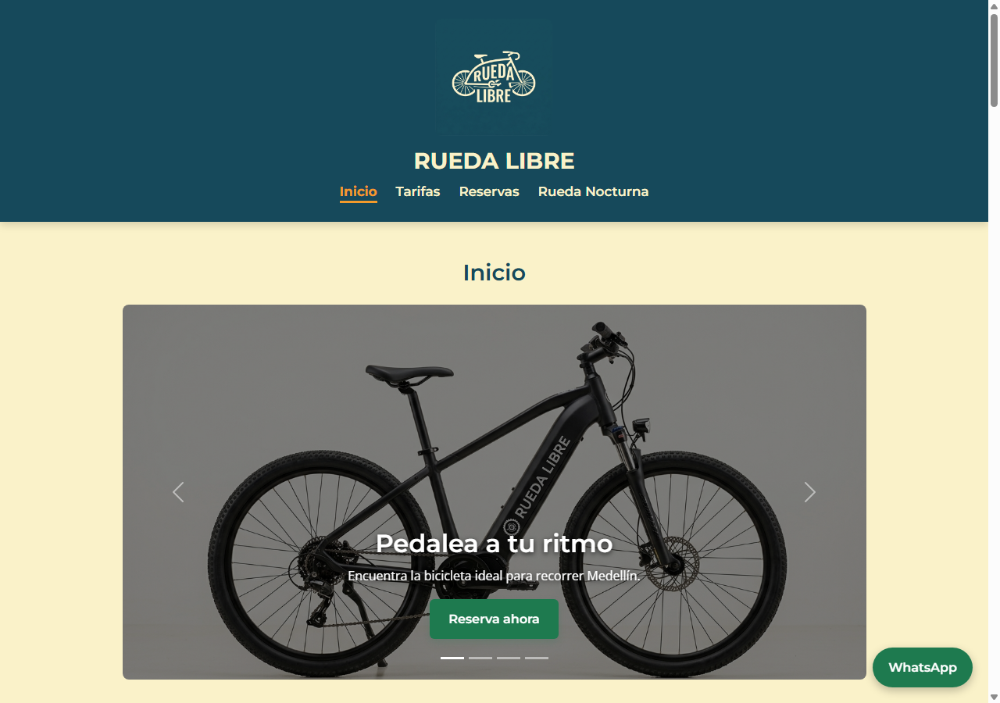
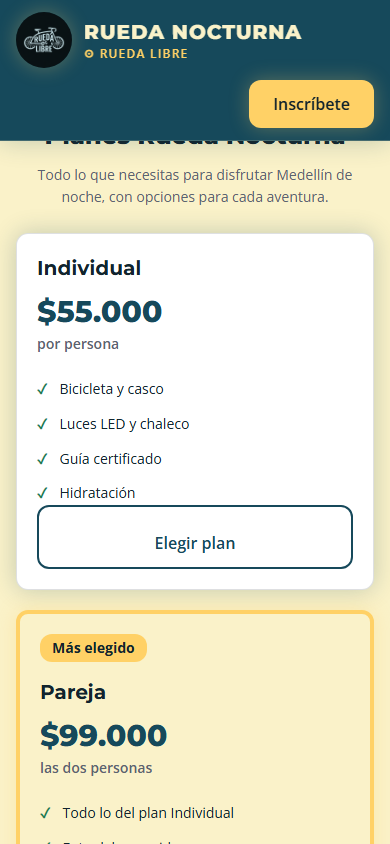
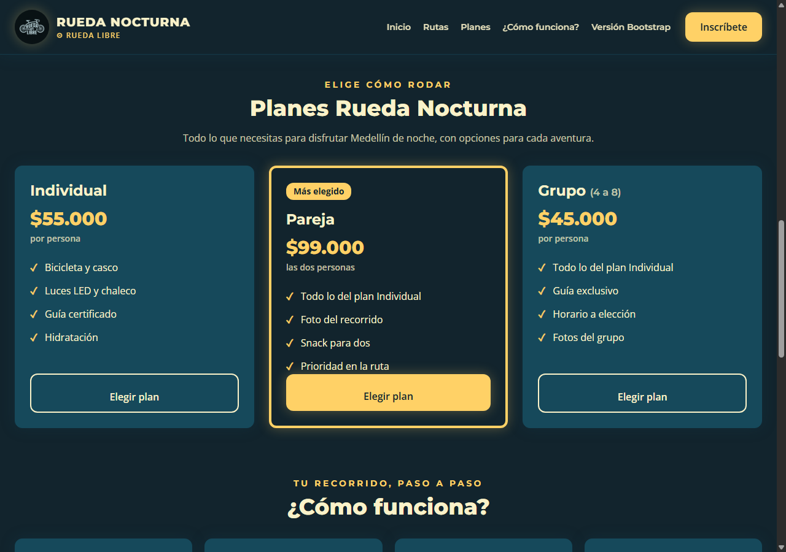

# Rueda Libre 2.0 y Rueda Nocturna

Sitio informativo de alquiler de bicicletas y rutas guiadas en Medellín, acompañado por la landing de Rueda Nocturna. Incluye tarifas, formularios de demostración y una presentación de rutas y planes nocturnos.

## Sitio publicado

- [Inicio](https://deivor88.github.io/rueda-libre/)
- [Tarifas](https://deivor88.github.io/rueda-libre/paginas/tarifas.html)
- [Reservas](https://deivor88.github.io/rueda-libre/paginas/reservas.html)
- [Rueda Nocturna — Tailwind](https://deivor88.github.io/rueda-libre/nocturna/index.html)
- [Rueda Nocturna — Bootstrap](https://deivor88.github.io/rueda-libre/nocturna/bootstrap.html)

## Páginas y tecnologías

- Sitio Rueda Libre: inicio, tarifas y reservas.
- Landing Rueda Nocturna: rutas, planes Individual/Pareja/Grupo, proceso de inscripción y versión alternativa en Bootstrap.
- HTML5 semántico, CSS, JavaScript, Tailwind CSS 4.3.5, Bootstrap 5.3.9 y GitHub Pages.
- Los estilos de la landing Bootstrap están en `nocturna/src/bootstrap.css`; las hojas de Tailwind se generan minificadas con `npm run build` en `nocturna/`.

## Capturas

| Escritorio | Celular | Modo oscuro |
| --- | --- | --- |
|  |  |  |

## Validación de entrega

- Validador W3C Nu ejecutado sobre Inicio, Tarifas, Reservas y las dos versiones de Rueda Nocturna: sin mensajes de error ni advertencia.
- Revisados textos alternativos, jerarquía de encabezados, etiquetas de formularios, navegación por teclado y foco visible.
- Diseño revisado en 360, 768 y 1280 px; la landing presenta una columna en móvil y tres desde `lg`.
- Tema claro y oscuro revisados; contraste del plan destacado revisado.
- Los enlaces y recursos locales se comprobaron para detectar errores 404.
- Tailwind genera `nocturna/src/output.css` y `nocturna/src/landing.min.css` minificados.
- Los formularios validan campos en el navegador, pero son demostraciones: no envían ni guardan datos y no confirman reservas. Para recibir solicitudes reales hace falta conectar un backend.
- Antes de promocionar el sitio, confirmar que los datos heredados de teléfono, correo y WhatsApp sean los contactos oficiales.

## Recomendación de framework — MiniReto 8

Recomiendo **Astro** para una siguiente iteración. El proyecto es principalmente contenido estático, y Astro permite compartir layouts y componentes sin añadir JavaScript al cliente cuando no hace falta. Se pueden conservar HTML y Tailwind, e integrar un servicio de reservas solo cuando exista un backend definido.

## Aprendizajes

- La semántica y las etiquetas accesibles mejoran tanto la navegación como la validación del HTML.
- Probar en varios anchos descubre problemas de distribución que no se ven en escritorio.
- La validación del navegador sirve para una demo, pero no sustituye un servicio que procese y almacene reservas.
- Hay que regenerar y versionar las hojas minificadas junto con los cambios de estilos.

## Demo de tres minutos

1. **0:00–0:25 — Contexto:** presentar Rueda Libre y la necesidad de mostrar rutas y planes nocturnos.
2. **0:25–1:00 — Sitio:** recorrer Inicio y Tarifas; abrir Reservas y explicar que el formulario solo valida datos.
3. **1:00–1:45 — Landing:** mostrar las rutas y comparar los planes, destacando Pareja como “Más elegido”.
4. **1:45–2:15 — Inscripción:** completar la validación de demostración sin usar datos personales.
5. **2:15–2:40 — Celular y tema oscuro:** mostrar el diseño responsive y activar la preferencia oscura del navegador o sistema.
6. **2:40–3:00 — Decisiones técnicas:** explicar la cuadrícula responsive con Tailwind y el uso de HTML semántico con formularios sin backend.

**Ensayo y retroalimentación:** pendiente de realizar con un compañero. No se registra una duración ni comentarios que todavía no se hayan recibido.

## Bitácora y tiempo

La bitácora original se conserva en [img/bitacora.txt](img/bitacora.txt). Para la sección de planes nocturnos, el tiempo registrado fue **00:03:41** dentro de la ventana de 45 minutos.

## Autor

David Alvarez
